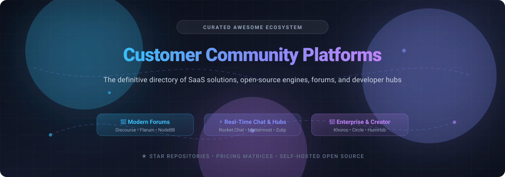

# Awesome-Customer-Community-Platform

  

  
  
  
  
  

---

## 🌟 Overview: Top Customer Community Platforms

> **A curated, battle-tested index of commercial SaaS products, enterprise community platforms, and open-source discussion engines.**  
> Focused on branded customer forums, developer hubs, real-time community chat, peer-to-peer support, and self-hosted collaboration suites.

**Last updated:** November 2026 🚀

Customer community platforms empower organizations to foster brand loyalty, deflect customer support tickets through peer-to-peer resolution, gather user product feedback, and run creator memberships. Whether your organization requires a SOC-2 compliant enterprise social care suite with AI moderation or an open-source self-hosted forum that provides 100% data sovereignty, this repository compiles verified pricing models, free tier limits, and GitHub popularity metrics.

---

## 📑 Table of Contents

- [📊 Sector Overview & Market Dynamics](#-sector-overview--market-dynamics)
- [💼 SaaS & Commercial Hosted Platforms](#-saas--commercial-hosted-platforms)
- [🔓 Open-Source GitHub Projects](#-open-source-github-projects)
- [🤝 How to Contribute](#-how-to-contribute)
- [💖 Support & Sponsorship](#-support--sponsorship)
- [⭐ Star History](#-star-history)
- [⚖️ Disclaimer & Compliance](#️-disclaimer--compliance)

---

## 📊 Sector Overview & Market Dynamics

The global online customer community platform sector is currently estimated at **$1.5B to $2.2B** (projected to reach over $3.7B–$7B by the mid-2030s at a healthy ~10–13% CAGR), expanding to **$13B–$14B+** when broader enterprise social networks and omnichannel customer engagement suites are incorporated. 

The market is **moderately fragmented**—distinct customer requirements prevent a winner-take-all monopoly:
* **Enterprise Customer Care & Support Deflection:** Platforms like **Khoros** and **Gainsight Customer Communities (inSided)** serve large enterprises with dedicated CRM and ticket workflows.
* **Creator Hubs & Digital Memberships:** Modern platforms like **Circle** and **Mighty Networks** dominate cohort courses, events, and community monetization.
* **Independent & Self-Hosted Forum Engines:** **Discourse**, **Flarum**, and **NodeBB** represent the gold standard for developer communities and brand discussions seeking data sovereignty.

---

## 💼 SaaS & Commercial Hosted Platforms

The following SaaS and managed customer community platforms are sorted in **descending order by company scale** (estimated valuation / annual recurring revenue).

| Platform | Starting Price | Free Tier / Trial Limits | Company Size (Valuation / Revenue) | Description & Key Strengths |
| :--- | :--- | :--- | :--- | :--- |
| **[Khoros Communities](https://khoros.com/)** | **$4,400/month** ($52,843/year entry benchmark; median contract ~$164,649/year) | **No free tier**; no self-serve free trial (custom enterprise sales demo on request) | **~$252M Revenue** (Acquired by IgniteTech; $307M+ raised previously) | Enterprise community platform within Khoros's omnichannel customer engagement and social care suite. |
| **[inSided](https://www.insided.com/)** *(by Gainsight)* | **$1,250/month** ($15,000/year entry baseline benchmark) | **No free tier**; no self-serve free trial (guided demo & customized pilot via sales) | **$1.1B Valuation** / **~$230M Revenue** (Acquired by Gainsight / Vista Equity Partners) | Customer community platform purpose-built for B2B SaaS customer success, product adoption, and ticket deflection. |
| **[Higher Logic Vanilla](https://www.higherlogic.com/)** | **$599/month** (Standard plan for up to 1,000 users; Enterprise packages ~$24,000–$80,000+/year) | **No free tier**; no self-serve trial (scheduled interactive demo available) | **$50M–$80M+ ARR** (Private equity-backed by JMI Equity & Level Equity) | Enterprise community forum engine tailored for customer support, associations, and integrated member engagement. |
| **[Circle](https://circle.so/)** | **$89/month** (Professional plan, billed annually; $99/mo billed monthly) | **14-day free trial** of paid tiers (no credit card required upfront; up to 3 admins and core feature access) | **~$68M ARR** ($33.3M total venture funding; profitable) | Modern all-in-one community hub combining discussions, structured courses, live events, workflows, and payments. |
| **[Discourse](https://www.discourse.org/)** *(Cloud)* | **$100/month** (Standard hosted plan; free self-hosting also available) | **Free plan forever**: **Unlimited members**, **unlimited chat**, **2 staff seats**, free `*.discourse.group` subdomain, preconfigured Discourse ID social login, automated updates/backups; **14-day free trial** for paid hosted tiers | **$10M–$35M+ ARR** (Profitable open-core enterprise; powers OpenAI, Figma, GitLab) | The gold standard open-core discussion platform, featuring robust trust levels, moderation tools, and extensible plugins. |
| **[Mighty Networks](https://www.mightynetworks.com/)** | **$41/month** (Community plan, billed annually; Launch plan at $79/mo) | **14-day free trial** of Growth/Scale feature set (no credit card required upfront; full access to spaces, events, and moderation tools) | **~$200M Valuation** (Series B) / **~$8.6M ARR** ($66M total funding) | Community and membership platform designed for creator networks, cohort courses, events, and livestreaming. |
| **[CMNTY](https://www.cmnty.com/)** | **$499/month** (Base plan per feature/project tier) | **No permanent free tier**; **Free trial / preview on request** (access granted within 24 hours via sales registration for customized pilot) | **Private / Subsidiary** (Acquired by MarketResponse Group; consolidated enterprise) | Specialized customer insights and collaborative market research community platform. |
| **[Bettermode](https://bettermode.com/)** | **$149/month** (Starter plan, billed annually; $199/mo billed monthly) | **14-day free trial** on paid plans (Starter/Growth, no credit card required); limited free tier (up to 100 members, 20 spaces, 1 GB storage) | **~$3.1M ARR** (Venture-backed startup) | Modular all-in-one customer community platform with customizable spaces, discussions, and widget integrations. |

> *📌 Note on Atlassian Community: While frequently referenced in community design discussions, Atlassian Community is Atlassian's own brand forum rather than a commercial software product available for purchase, and is therefore excluded from vendor software comparisons.*

---

## 🔓 Open-Source GitHub Projects

Open-source community software gives teams 100% data ownership, custom branding freedom, self-hosting flexibility, and privacy compliance. The projects below are sorted in **descending order by GitHub star count**.

### 1. **[Discourse](https://github.com/discourse/discourse)** 
- **License:** GPL-2.0 📜
- **Tech Stack:** Ruby on Rails, PostgreSQL, Redis, Ember.js 🛠️
- **Description:** The industry standard for modern community discussions and peer support, trusted by Figma, Docker, Mozilla, OpenAI, and Rust. Features progressive trust levels, automated anti-spam (Akismet), dynamic tagging, rich markdown formatting, SSO integration (SAML, OAuth, OIDC), and an extensive ecosystem of hundreds of official plugins.
- **Hosting Options:** Self-hosted via Docker container or official Discourse Cloud (including a permanently free tier for small teams).

### 2. **[Rocket.Chat](https://github.com/RocketChat/Rocket.Chat)** 
- **License:** GPL-3.0 📜
- **Tech Stack:** Node.js, TypeScript, MongoDB 🛠️
- **Description:** A powerhouse open-source communications platform and customer engagement engine. Built for organizations needing real-time customer channels, live-chat widgets for websites, team collaboration, end-to-end encryption, and omnichannel customer support ticketing.
- **Hosting Options:** Self-hosted on Docker, Kubernetes, or managed cloud.

### 3. **[Mattermost](https://github.com/mattermost/mattermost)** 
- **License:** AGPL-3.0 / Apache-2.0 📜
- **Tech Stack:** Go, React, PostgreSQL/MySQL 🛠️
- **Description:** Open-source platform for mission-critical collaboration, developer communities, and technical customer workflows. Combines real-time threaded chat, automated operational playbooks, and kanban-style project boards with strict security compliance.
- **Hosting Options:** Self-hosted Linux binary/Docker, or enterprise private cloud.

### 4. **[Zulip](https://github.com/zulip/zulip)** 
- **License:** Apache-2.0 📜
- **Tech Stack:** Python (Django), TypeScript, PostgreSQL 🛠️
- **Description:** Unique topic-based threading model that combines the immediacy of real-time group chat with the asynchronous structure of forum boards. Ideal for fast-moving customer communities, open-source project contributors, and global distributed teams.
- **Hosting Options:** Docker, native Ubuntu/Debian installer, or Zulip Cloud.

### 5. **[Forem](https://github.com/forem/forem)** 
- **License:** AGPL-3.0 📜
- **Tech Stack:** Ruby on Rails, PostgreSQL, Redis, Preact 🛠️
- **Description:** The open-source platform powering the DEV Community and CodeNewbie. Purpose-built for high-volume content sharing, long-form articles, discussion threads, podcasts, community listings, and developer networks.
- **Hosting Options:** Self-hosted on Linux/AWS, or containerized deployment.

### 6. **[Flarum](https://github.com/flarum/flarum)** 
- **License:** MIT 📜
- **Tech Stack:** PHP, Mithril.js, MySQL/MariaDB 🛠️
- **Description:** Delightfully simple, lightning-fast forum software built with a modular extension architecture. Requires minimal server resources (runs comfortably on 512MB RAM), offering infinite scrolling, floating composer, clean notification trays, and rapid setup.
- **Hosting Options:** Lightweight self-hosting on standard LAMP/LEMP stacks, Composer, or Docker.

### 7. **[NodeBB](https://github.com/NodeBB/NodeBB)** 
- **License:** GPL-3.0 📜
- **Tech Stack:** Node.js, Redis / MongoDB / PostgreSQL 🛠️
- **Description:** Next-generation forum software utilizing instant WebSockets for real-time streaming notifications, live chat, reputation voting, and seamless mobile responsiveness. Provides extensive RESTful APIs and webhook support.
- **Hosting Options:** Self-hosted Node.js runtime or managed hosting.

### 8. **[Lemmy](https://github.com/LemmyNet/lemmy)** 
- **License:** AGPL-3.0 📜
- **Tech Stack:** Rust, Actix, TypeScript, PostgreSQL 🛠️
- **Description:** Federated link-aggregation and discussion platform powered by ActivityPub. Enables organizations and interest groups to run decentralized, federated communities that interconnect across the broader Fediverse.
- **Hosting Options:** Docker Compose, Kubernetes, or native Rust deployment.

### 9. **[HumHub](https://github.com/humhub/humhub)** 
- **License:** AGPL-3.0 📜
- **Tech Stack:** PHP (Yii 2), MariaDB / MySQL 🛠️
- **Description:** Flexible open-source social network kit and customer community portal. Includes member spaces, activity streams, member directories, file sharing, calendar events, polls, and an integrated modular marketplace.
- **Hosting Options:** Standard PHP web server or Docker.

### 10. **[WriteFreely](https://github.com/writefreely/writefreely)** 
- **License:** AGPL-3.0 📜
- **Tech Stack:** Go, SQLite / MySQL 🛠️
- **Description:** Clean, distraction-free blogging and community publishing platform. Built for writer collectives, collaborative team documentation, and federated publishing using ActivityPub.
- **Hosting Options:** Single lightweight Go binary, Docker, or managed cloud.

---

## 🤝 How to Contribute

Contributions are warmly welcomed! Help keep this customer community ecosystem comprehensive and up to date:

1. 🍴 **Fork the repository** on GitHub.
2. 🌿 **Create a branch** for your feature or update (`git checkout -b add-platform-entry`).
3. 📝 **Add or update entries** in `README.md` following the tabular format for SaaS platforms or the standardized list format for open-source tools.
4. 💡 Ensure you include: platform name, official URL, pricing/license, key strengths, and valid GitHub repository link.
5. 🚀 **Submit a Pull Request** with a descriptive summary of your additions.

---

## 💖 Support & Sponsorship

If this curated repository saved you time evaluating customer community platforms, helped your team select the right architecture, or contributed to your project:

- ⭐ **Star this repository** to help others discover it!
- 🍴 **Fork and share** with colleagues and community managers.
- ☕ **Buy us a coffee or sponsor ongoing maintenance:**  
  👉 **[Sponsor on GitHub: https://github.com/sponsors/ishandutta2007](https://github.com/sponsors/ishandutta2007)**

Your generous sponsorship directly supports continuous research, software benchmark tracking, and community resource curation! 🙏

---

##  Star History

---

## ⚖️ Disclaimer & Compliance

- This repository is a **community-curated index** created for educational, benchmarking, and architectural evaluation purposes.
- All trademarks, service marks, and trade names are the property of their respective owners.
- Customer community platforms process personally identifiable information (PII) and user-generated content. Organizations should ensure proper compliance with global privacy regulations (e.g., GDPR, CCPA/CPRA, SOC-2, and HIPAA) when handling member data.
- Pricing metrics, plan tiers, and limits are subject to change by vendors; always verify directly with vendor sales and official product documentation.

---

  <b>Built with ❤️ for community architects, developer advocates, and community managers worldwide.</b>

